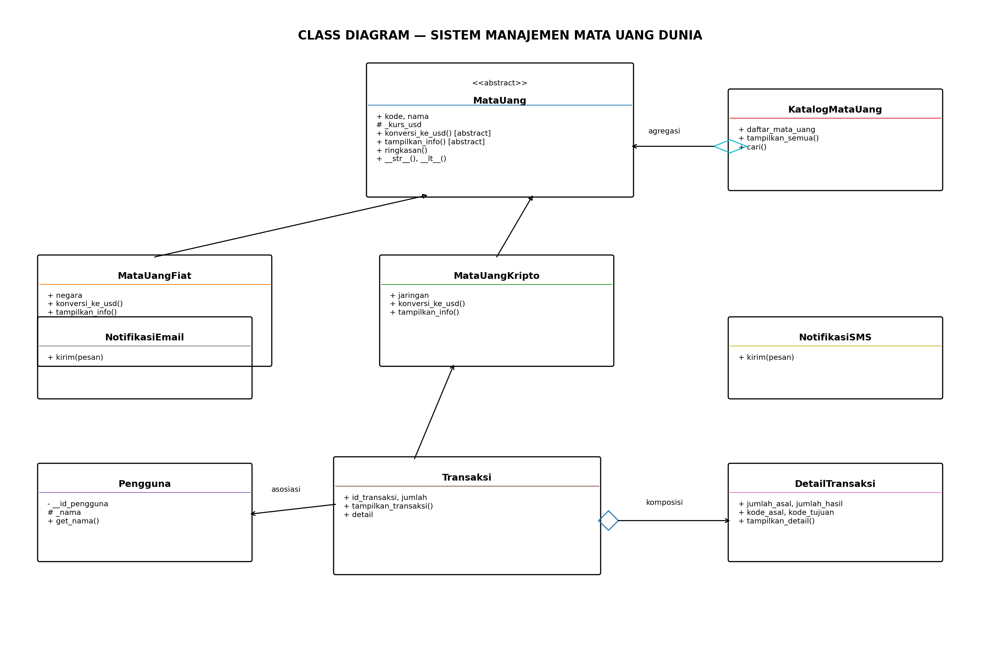

# Sistem Manajemen Mata Uang Dunia

## 1. Deskripsi Program

Sistem Manajemen Mata Uang Dunia adalah program Python sederhana untuk menampilkan beberapa mata uang, menunjukkan informasi mata uang fiat dan kripto, serta melakukan simulasi konversi berdasarkan kurs contoh. Program ini dibuat untuk menerapkan konsep OOP, abstraksi, inheritance, polimorfisme, duck typing, operator overloading, dan relasi UML.

**Catatan:** Kurs USD, IDR, EUR, dan BTC di dalam program merupakan angka contoh untuk simulasi pembelajaran, bukan kurs real-time atau saran keuangan.

## 2. Class Diagram



## 3. Penjelasan Relasi UML

### A. Asosiasi — `Transaksi` dengan `Pengguna` dan `MataUang`

Objek `Transaksi` menerima objek `Pengguna`, mata uang asal, dan mata uang tujuan melalui parameter konstruktor. Objek-objek tersebut dibuat di luar `Transaksi` dan digunakan oleh transaksi untuk menampilkan informasi serta menghitung konversi.

### B. Agregasi — `KatalogMataUang` dengan `MataUang`

`KatalogMataUang` menerima daftar objek mata uang yang sudah dibuat di luar kelas katalog. Karena katalog hanya menampung referensi objek yang sudah ada, objek mata uang tetap dapat digunakan meskipun katalog tidak lagi digunakan.

### C. Komposisi — `Transaksi` dengan `DetailTransaksi`

Objek `DetailTransaksi` dibuat langsung di dalam konstruktor `Transaksi` dan disimpan sebagai atribut `detail`. Dalam rancangan ini, detail merupakan bagian milik transaksi dan tidak diberikan dari luar sebagai objek mandiri.

## 4. Penerapan Abstraksi

Abstraksi dibuat menggunakan kelas `MataUang` yang mewarisi `ABC`. Kelas tersebut memiliki dua abstract method, yaitu `konversi_ke_usd()` dan `tampilkan_info()`, serta method konkret `ringkasan()` yang dapat digunakan bersama oleh semua subclass.

Kelas `MataUangFiat` dan `MataUangKripto` mengimplementasikan kedua abstract method. Program juga mencoba membuat objek `MataUang` secara langsung menggunakan `try-except TypeError`. Output `TypeError` menjadi bukti bahwa abstract class tidak dapat diinstansiasi.

## 5. Penerapan Inheritance dan Polimorfisme

### A. Inheritance

`MataUangFiat` dan `MataUangKripto` mewarisi kelas `MataUang`. Keduanya memanggil `super().__init__(...)` dan memiliki atribut unik, yaitu `negara` untuk mata uang fiat serta `jaringan` untuk mata uang kripto.

### B. Polimorfisme melalui Pewarisan

Method `tampilkan_info()` dan `konversi_ke_usd()` diimplementasikan dengan perilaku masing-masing pada `MataUangFiat` dan `MataUangKripto`. Method `tampilkan_info()` dipanggil melalui satu loop yang berisi objek dari kedua subclass.

### C. Duck Typing

Kelas `NotifikasiEmail` dan `NotifikasiSMS` tidak saling mewarisi, tetapi keduanya memiliki method `kirim()`. Fungsi `kirim_notifikasi()` dapat memanggil keduanya tanpa memeriksa tipe objek menggunakan `type()`.

### D. Operator Overloading

Kelas `MataUang` memiliki magic method `__str__()` untuk menampilkan representasi objek dan `__lt__()` untuk membandingkan nilai kurs dua objek mata uang menggunakan operator `<`.

## 6. Encapsulation

Kelas `Pengguna` memiliki atribut private `__id_pengguna` dan atribut protected `_nama`. Atribut private diakses melalui method `get_id()`, sedangkan nama pengguna diperoleh melalui `get_nama()`.

## 7. Penerapan Prinsip SOLID

Prinsip Dependency Inversion Principle (DIP) diterapkan pada kelas `Transaksi`. Kelas tersebut menggunakan objek melalui kontrak abstrak `MataUang`, bukan membuat objek `MataUangFiat` atau `MataUangKripto` sendiri di dalam konstruktor. Objek mata uang diberikan dari luar sehingga implementasinya dapat diganti dengan subclass lain yang memenuhi kontrak `MataUang`.

## 8. Screenshot Output Program

Tambahkan screenshot hasil menjalankan `main.py` pada bagian ini. Pastikan screenshot memperlihatkan:

1. Bukti `TypeError` saat abstract class `MataUang` dicoba untuk diinstansiasi.
2. Informasi mata uang fiat dan kripto.
3. Hasil konversi transaksi.
4. Polimorfisme, operator overloading, dan duck typing.

Contoh struktur penyimpanan screenshot:

```text
screenshots/
├── bukti_abstraksi.png
├── data_mata_uang.png
└── transaksi_polimorfisme.png
```

Screenshot harus berasal dari program yang benar-benar dijalankan.

## 9. Cara Menjalankan Program

Pastikan Python sudah terpasang. Buka terminal pada folder proyek, kemudian jalankan:

```bash
python main.py
```

Pada beberapa instalasi Windows, perintah berikut juga dapat digunakan:

```bash
py main.py
```

## 10. Kesimpulan

Program ini menerapkan abstract class dengan dua abstract method, dua subclass, method konkret bersama, bukti kegagalan instansiasi abstract class, inheritance, overriding, duck typing, operator overloading, dan relasi UML asosiasi, agregasi, serta komposisi. Program juga menunjukkan penerapan DIP melalui penggunaan kontrak abstrak pada transaksi.
